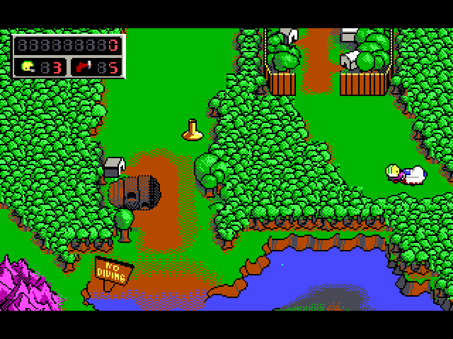
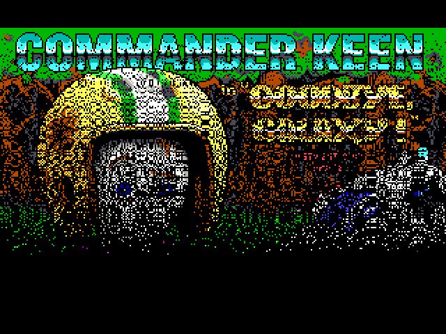
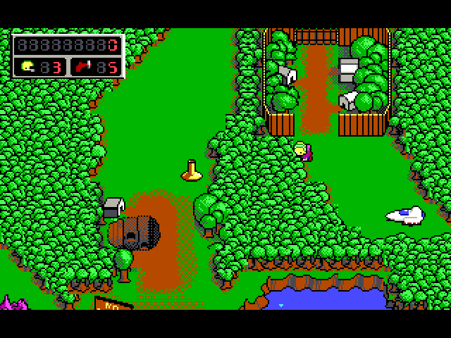

# Commander Keen: Goodbye, Galaxy!

**Omnispeak, Keen 4, 5 and 6, on the Amiga.**

  

  
  

Captured from this build running on AmigaOS.

Billy Blaze is back in his football helmet. Omnispeak is David Gow's pixel-perfect, bug-for-bug re-implementation of Commander Keen episodes 4, 5 and 6, compatible with the DOS saves, and this is its native Amiga build, with the AdLib music played through AHI.

## What you need

A 68040 with an FPU, AmigaOS 3.2 or later, AHI. AGA or an RTG card.

The game data is not included. Put the program, one episode's Omnispeak files and that episode's own `GAMEMAPS`, `AUDIO` and `EGAGRAPH` files in one drawer and run it there. Keen 4's shareware data is free.

## Controls

| Key | Does |
|---|---|
| Arrows | Move, look |
| Ctrl | Jump |
| Alt | Pogo stick |
| Space | Fire the neural stunner |
| Esc | Menu |
| F1 | Help |

## What works

- Intro, title, menus, the world map and the levels on AGA and RTG
- AdLib music and sound effects through AHI
- The game finds its episode by itself

## Not in this build yet

- No overscan border: the screen is 320x200

## Building

The Amiga build, its make file and what was changed for the 68k are described in [AMIGA_PORT.md](AMIGA_PORT.md).

## Credits and licence

Omnispeak by David Gow and contributors, from id Software's Commander Keen ([upstream](https://github.com/sulix/omnispeak)). Licence: GPL 2.

Amiga port by The AmiCradle Team.

The original project's README is [README](README).
